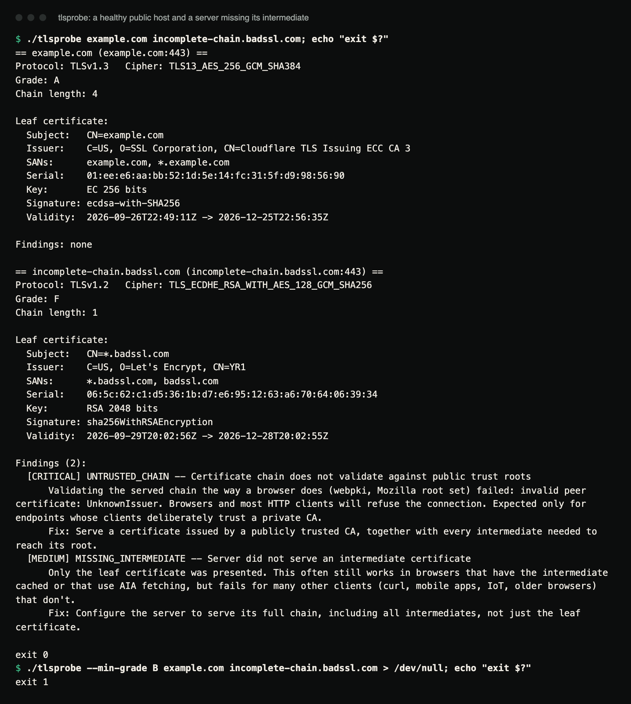

# tlsprobe

Audit a TLS endpoint's certificate chain, expiry, and protocol/cipher
configuration, and get back plain-language findings with severity and
remediation instead of a wall of protocol facts.

## Demo



A real run of a release build against two public hosts: `example.com`, and
`incomplete-chain.badssl.com`, a test server from badssl.com that
deliberately serves its leaf certificate without the intermediate. Without
`--min-grade` the exit status is 0 even for an F; with `--min-grade B` it
is 1. Certificate details will change as these hosts renew.

```console
$ ./tlsprobe example.com incomplete-chain.badssl.com; echo "exit $?"
== example.com (example.com:443) ==
Protocol: TLSv1.3   Cipher: TLS13_AES_256_GCM_SHA384
Grade: A
Chain length: 4

Leaf certificate:
  Subject:   CN=example.com
  Issuer:    C=US, O=SSL Corporation, CN=Cloudflare TLS Issuing ECC CA 3
  SANs:      example.com, *.example.com
  Serial:    01:ee:e6:aa:bb:52:1d:5e:14:fc:31:5f:d9:98:56:90
  Key:       EC 256 bits
  Signature: ecdsa-with-SHA256
  Validity:  2026-09-26T22:49:11Z -> 2026-12-25T22:56:35Z

Findings: none

== incomplete-chain.badssl.com (incomplete-chain.badssl.com:443) ==
Protocol: TLSv1.2   Cipher: TLS_ECDHE_RSA_WITH_AES_128_GCM_SHA256
Grade: F
Chain length: 1

Leaf certificate:
  Subject:   CN=*.badssl.com
  Issuer:    C=US, O=Let's Encrypt, CN=YR1
  SANs:      *.badssl.com, badssl.com
  Serial:    06:5c:62:c1:d5:36:1b:d7:e6:95:12:63:a6:70:64:06:39:34
  Key:       RSA 2048 bits
  Signature: sha256WithRSAEncryption
  Validity:  2026-09-29T20:02:56Z -> 2026-12-28T20:02:55Z

Findings (2):
  [CRITICAL] UNTRUSTED_CHAIN -- Certificate chain does not validate against public trust roots
      Validating the served chain the way a browser does (webpki, Mozilla root set) failed: invalid peer certificate: UnknownIssuer. Browsers and most HTTP clients will refuse the connection. Expected only for endpoints whose clients deliberately trust a private CA.
      Fix: Serve a certificate issued by a publicly trusted CA, together with every intermediate needed to reach its root.
  [MEDIUM] MISSING_INTERMEDIATE -- Server did not serve an intermediate certificate
      Only the leaf certificate was presented. This often still works in browsers that have the intermediate cached or that use AIA fetching, but fails for many other clients (curl, mobile apps, IoT, older browsers) that don't.
      Fix: Configure the server to serve its full chain, including all intermediates, not just the leaf certificate.

exit 0
$ ./tlsprobe --min-grade B example.com incomplete-chain.badssl.com > /dev/null; echo "exit $?"
exit 1
```

## What

`tlsprobe` connects to a host over TLS, inspects the certificate chain the
server actually serves, and checks it against a set of practical rules:
is it expired or about to be, does the chain validate the way a browser
expects, is the key or signature algorithm weak, does the hostname
actually match, is the negotiated protocol or cipher suite deprecated.
Each problem it finds comes with a severity and a concrete remediation
step, and the whole audit is summarized as a single A–F grade.

## Why

Most TLS checkers dump every protocol detail they can extract and leave
you to interpret it. What you actually need to know as an operator is:
*when does this expire, will this work in a real browser, is anything
here actually dangerous, and what do I do about it.* `tlsprobe` is built
around that question.

## Features

- **Certificate inspection**: subject, issuer, SANs, validity window,
  days to expiry, key algorithm and size, signature algorithm, serial.
- **Chain analysis**: validation of the served chain against the public
  web PKI roots (Mozilla's set via `webpki-roots`, the same `webpki` path
  validation a rustls client performs), chain length, self-signed
  detection, chain ordering, and detection of a very common real misconfiguration: a
  server that serves its leaf certificate without the intermediate. That
  setup often still works in browsers that cache the intermediate or do
  AIA fetching, and fails for everything else (curl, mobile apps, IoT).
- **Findings with severity and remediation** in the style of a security
  report; see the [reference table](#findings-reference) below.
- **Protocol/cipher reporting** for the negotiated connection. Note the
  limit: tlsprobe speaks TLS through rustls, which only negotiates TLS 1.2
  and 1.3 with modern AEAD suites. A server that offers *only* older
  protocols or weak ciphers fails the handshake (reported as an error),
  and tlsprobe does **not** detect whether a server *additionally* enables
  them. The `DEPRECATED_PROTOCOL` / `WEAK_CIPHER` rules exist for the
  negotiated values but cannot fire against a real server today.
- **A–F grading**, text and JSON output, a `--min-grade` gate for CI, and
  support for auditing multiple targets in one invocation.

## Architecture

The crate is deliberately split so the rule set is testable without a
network:

```
src/
  cert.rs      Parses DER certificates into plain data (CertInfo, ChainInfo).
               No network access.
  fetch.rs     Connects over TLS (rustls), gathers the served chain and
               negotiated connection parameters. No analysis.
  analysis.rs  Pure functions: (ChainInfo, ConnectionInfo, now) -> Vec<Finding>.
               Every rule lives here and is unit-tested with fixture data
               entirely offline.
  report.rs    Renders a Report (chain + connection + findings + grade) as
               text or JSON.
  main.rs      CLI (clap): wires fetch -> analysis -> report together.
```

`fetch.rs` uses a permissive certificate verifier on purpose: this tool's
job is to audit whatever a server presents, including broken or invalid
chains. A normal HTTPS client would abort the handshake exactly where
this tool needs to start looking.

No OpenSSL anywhere in the dependency tree: TLS is `rustls`, trust
anchors are `webpki-roots`, and certificate parsing is `x509-parser`.

## Installation

```sh
git clone https://github.com/hellpuffyt/tlsprobe
cd tlsprobe
cargo build --release
# binary at target/release/tlsprobe
```

Requires Rust 1.88 or newer (see [MSRV](#msrv)).

## Usage

```sh
# Audit one host (defaults to port 443)
tlsprobe example.com

# Audit multiple targets, some with explicit ports (IPv6: [::1]:8443)
tlsprobe example.com internal.example.com:8443

# Machine-readable output
tlsprobe --json example.com

# CI gate: fail (nonzero exit) if the grade drops below B on any target
tlsprobe --min-grade B example.com

# Custom timeout / default port
tlsprobe --timeout 5 --port 8443 example.com
```

| Option | Default | Meaning |
|---|---|---|
| `TARGET...` | required | one or more `host`, `host:port`, `[ipv6]:port` |
| `--port` | `443` | port for targets that don't give one |
| `--timeout` | `10` | connection timeout in seconds |
| `--json` | off | print a JSON array of reports on stdout; connection errors go to stderr as JSON objects |
| `--min-grade` | none | exit 1 if any target grades below this letter (A to F, case-insensitive) |

Exit status is 1 if any target could not be probed (DNS failure, refused
connection, timeout, failed handshake) or, with `--min-grade`, if any grade
is below the gate; otherwise 0.

Text output against a local test server (`openssl s_server` with a
throwaway self-signed certificate for `localhost` / `127.0.0.1`), output
trimmed after the first finding:

```
$ tlsprobe 127.0.0.1:18950
== 127.0.0.1:18950 (127.0.0.1:18950) ==
Protocol: TLSv1.3   Cipher: TLS13_AES_256_GCM_SHA384
Grade: F
Chain length: 1

Leaf certificate:
  Subject:   CN=localhost
  Issuer:    CN=localhost
  SANs:      localhost, 127.0.0.1
  Serial:    57:d2:f8:c9:cc:fa:8a:2e:84:df:61:36:8d:77:9e:8f:2f:d1:39:9e
  Key:       EC 256 bits
  Signature: ecdsa-with-SHA256
  Validity:  2026-10-22T14:02:00Z -> 2027-01-20T14:02:00Z

Findings (2):
  [CRITICAL] UNTRUSTED_CHAIN -- Certificate chain does not validate against public trust roots
      Validating the served chain the way a browser does (webpki, Mozilla root set) failed: invalid peer certificate: Other(OtherError(CaUsedAsEndEntity)). Browsers and most HTTP clients will refuse the connection. Expected only for endpoints whose clients deliberately trust a private CA.
      Fix: Serve a certificate issued by a publicly trusted CA, together with every intermediate needed to reach its root.
  [HIGH] SELF_SIGNED -- Leaf certificate is self-signed
      ...
```

The exit status is 0 here because no `--min-grade` was given.

## Findings reference

| ID | Severity | What it means | Remediation |
| --- | --- | --- | --- |
| `EXPIRED` | Critical | Certificate's `not_after` is in the past. | Renew and deploy immediately. |
| `EXPIRING_CRITICAL` | High | Expires within 7 days. | Renew now. |
| `EXPIRING_WARNING` | Medium | Expires within 30 days. | Schedule renewal, ideally via ACME automation. |
| `UNTRUSTED_CHAIN` | Critical | The served chain does not validate to a root in the public web PKI (unknown issuer, missing intermediate, bad signature, ...). Expiry and hostname problems are excluded here; they have their own findings. | Serve a publicly trusted certificate with its full chain. Expected for private-CA endpoints. |
| `HOSTNAME_MISMATCH` | Critical | Requested hostname (or IP address) isn't in the cert's SANs (wildcards supported). | Issue a cert covering the hostname, or connect to a covered one. |
| `WEAK_SIGNATURE_MD5` | High | Certificate signed with MD5. | Reissue with SHA-256 or stronger. |
| `WEAK_SIGNATURE_SHA1` | High | Certificate signed with SHA-1. | Reissue with SHA-256 or stronger. |
| `WEAK_KEY_RSA` | High | RSA key smaller than 2048 bits. | Reissue with >=2048-bit RSA or switch to EC. |
| `SELF_SIGNED` | High | Leaf certificate's issuer equals its subject. | Use a publicly trusted CA for anything reachable by real clients. |
| `MISSING_INTERMEDIATE` | Medium | Server served only the leaf, no intermediate. | Configure the server to serve its full chain. |
| `CHAIN_ORDER` | Medium | Served certificates aren't in issuer-linked order. | Serve leaf-to-root, verify each issuer actually issued the next cert. |
| `LONG_VALIDITY` | Low | Validity period exceeds 398 days (CA/Browser Forum baseline). | Reissue at <=398 days; prefer short-lived automated issuance. |
| `DEPRECATED_PROTOCOL` | High | Negotiated SSLv2/SSLv3/TLS 1.0/TLS 1.1 (cannot occur with rustls; see Features). | Disable on the server; require TLS 1.2+, prefer TLS 1.3. |
| `WEAK_CIPHER` | Medium | Negotiated cipher suite is RC4/3DES/DES/NULL/EXPORT/MD5/legacy-CBC (cannot occur with rustls; see Features). | Restrict to modern AEAD suites. |

Grading: any `Critical` finding forces an `F`. Otherwise the grade starts
at 100 and subtracts per finding (High -20, Medium -10, Low -4), then maps
to A (90+) / B (80+) / C (70+) / D (60+) / F.

## Testing

```sh
cargo test --all-targets        # 79 tests: 62 library, 4 target parsing, 4 integration, 9 trust
cargo fmt --all -- --check
cargo clippy --all-targets -- -D warnings
```

CI runs the tests on Ubuntu, Windows and macOS, fmt and clippy, the test
suite again on the 1.88 toolchain, and a release smoke test that probes
`google.com` (the only CI step that needs the public internet).

The rule set in `src/analysis.rs` is tested entirely offline against
in-memory fixture data, and every rule has both a triggering case and a
false-positive guard. `src/cert.rs` is tested against real DER
certificates generated on the fly with `rcgen` (no OpenSSL, no committed
key material). The integration tests in `tests/integration.rs` spin up a
throwaway TLS server on `127.0.0.1` and probe it end-to-end;
`tests/trust.rs` builds a root → intermediate → leaf PKI at runtime and
checks trust validation (trusted with the test root, untrusted against
the public roots, broken by a missing intermediate, not masked by expiry
or a name mismatch), probes servers that close immediately or never
answer, IPv6 targets, and JSON error output. None of the test suite
requires reaching the public internet, and no key material is committed.

## Security

- `#![forbid(unsafe_code)]` at the crate level.
- No OpenSSL: the entire TLS/crypto/parsing stack is pure Rust.
- `tlsprobe` intentionally does **not** reject invalid certificate chains
  during the handshake. That's the point of the tool: it audits what
  a server presents, including misconfigurations. Do not mistake a
  successful `tlsprobe` run for proof a connection is trustworthy; read
  the findings and the grade.
- No secrets, private keys, or credentials are read, stored, or
  transmitted by this tool.

Found a security issue in `tlsprobe` itself? Please report it privately
as described in [SECURITY.md](SECURITY.md).

## License

MIT. See [LICENSE](LICENSE).

## MSRV

Rust 1.88, verified in CI against the `1.88` toolchain directly (not just
"whatever `stable` happens to be").
